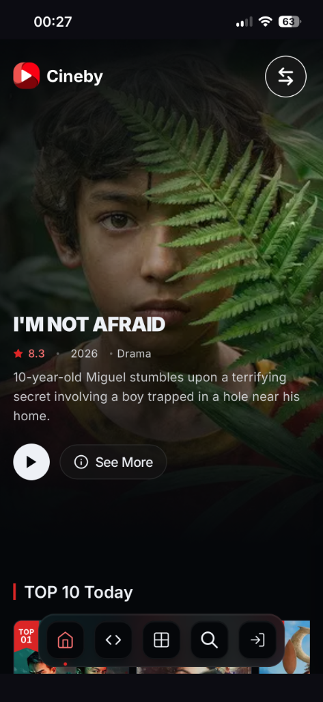
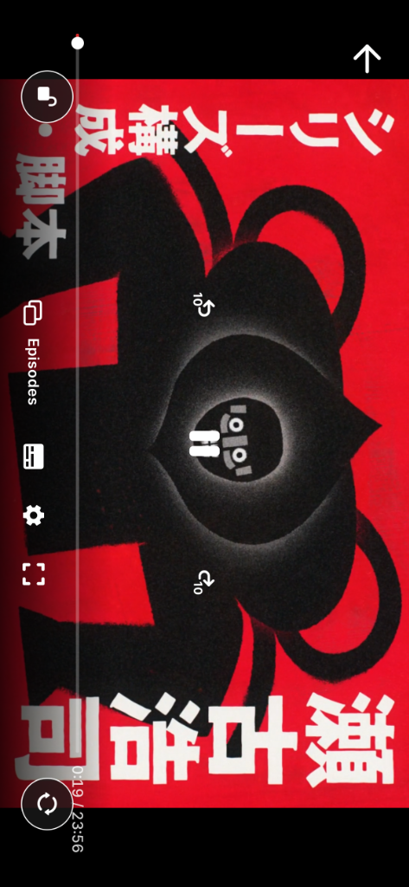

<div align="center">

# Mstream iOS

Wrapper iOS untuk portal streaming **Cineby** (film & serial) dan **Nimegami** (anime), dengan pembungkus `WKWebView` yang menambal kekurangan player web-nya.

[](#)
[](https://swift.org)
[](https://developer.apple.com/ios/)

<!-- lang-switcher -->
[English](README.md) · **Bahasa Indonesia**

</div>

---

## Kenapa Ada

Player web di kedua portal itu punya tiga masalah saat dibuka di iPhone:

1. **Screen Rotation Lock** memblokir mode landscape, jadi video cuma bisa ditonton dalam portrait.
2. **Player tidak pernah benar-benar fullscreen** — masih ada margin dan safe-area.
3. **Tidak ada cara mengunci layar** saat menonton, sehingga sentuhan tak sengaja membuat video ter-pause atau melompat.

Mstream menambal ketiganya dari sisi native, tanpa mengubah situsnya.

## Fitur

### Bypass Orientation Lock
Menonton fullscreen landscape tetap bisa walau **Screen Rotation Lock** sedang aktif. Diimplementasikan di `AppDelegate.swift` lewat `supportedInterfaceOrientationsFor`.

### Netflix-Style Playback Lock
Tombol kunci merah menonaktifkan seluruh interaksi sentuh pada WebView — mencegah pause/seeking tak sengaja sekaligus memblokir pop-up dan klik iklan yang dipicu skrip.

- Auto-hide setelah 3 detik tanpa interaksi.
- Tap di mana saja untuk memunculkan atau menyembunyikan tombol kunci.

### Floating Controls
Tombol kontrol bulat 50×50 memakai **SF Symbols**, menggantikan navigation header di mode portrait maupun landscape.

- **Rotate button context-sensitive** — hanya muncul saat elemen `<video>` terdeteksi di halaman, dan hilang saat sedang menelusuri daftar atau deskripsi.

### Edge-to-Edge Fullscreen
Menimpa `viewport` HTML dan safe-area margin saat landscape agar video mengisi layar penuh.

### Multi-Portal
Layar pemilihan portal saat aplikasi dibuka (Cineby atau Nimegami), plus tombol switch mengambang dengan transisi cross-dissolve. Tombol switch otomatis disembunyikan saat menonton video landscape.

## Screenshot

| Portrait | Landscape (player) |
| --- | --- |
|  |  |

## Tech Stack

| Bagian | Teknologi |
| --- | --- |
| Bahasa | Swift 5 |
| UI | UIKit (`UIViewController`, `UINavigationController`) |
| Web | `WKWebView` + `WKUserScript` |
| Build | Xcode + GitHub Actions (signed & unsigned) |
| Alternatif | Capacitor wrapper di `capacitor-app/` |

## Struktur

```
ios-cineby/                            # sumber native (Swift)
  AppDelegate.swift                    # bypass orientation lock
  SceneDelegate.swift
  WebViewController.swift              # inti: player, floating controls, lock
  OrientationNavigationController.swift
capacitor-app/                         # wrapper Capacitor + aset web
  capacitor.config.json
  patch_ios.sh                         # patch project iOS hasil generate
fastlane/                              # Appfile, Fastfile, Matchfile (signing)
.github/workflows/
  ios-build.yml                        # build signed
  ios-build-unsigned.yml               # build IPA unsigned
screenshots/
```

## Build

Repo ini **tidak menyimpan `*.xcodeproj`** — project iOS di-generate oleh Capacitor saat build. Ada dua jalur.

### A. IPA unsigned via GitHub Actions (paling mudah)

Workflow `ios-build-unsigned.yml` berjalan saat push ke `main`/`master`, atau manual lewat tab **Actions → Run workflow**. Hasilnya artifact berisi IPA unsigned, siap dipakai Sideloadly/AltStore.

### B. Build lokal

Butuh macOS + Xcode.

```bash
cd capacitor-app
npm install
npx @capacitor/cli add ios --packagemanager SPM   # sekali saja
npx @capacitor/cli copy ios
bash patch_ios.sh

cd ios/App
xcodebuild -workspace App.xcworkspace -scheme App -configuration Release \
  -sdk iphoneos archive -archivePath build/App.xcarchive CODE_SIGNING_ALLOWED=NO
```

Setelah project ter-generate, kamu juga bisa membukanya di Xcode:

```bash
open ios/App/App.xcworkspace
```

Workflow memaksa `IPHONEOS_DEPLOYMENT_TARGET` ke **26.0** pada Podfile, `project.pbxproj`, dan `.xcconfig`. Kalau build lokal gagal karena target version, itu penyebabnya.

### Sideload

Pasang IPA lewat **Sideloadly** atau **AltStore**. Build ke perangkat fisik butuh signing certificate Apple Developer.

## Cara Pakai

1. Buka aplikasi, pilih portal (Cineby / Nimegami).
2. Pilih judul, mulai menonton.
3. Putar perangkat ke landscape — fullscreen aktif walau Rotation Lock menyala.
4. Tap tombol kunci merah untuk mengunci layar saat menonton.

## Disclaimer

Project ini hanya klien. Seluruh konten berasal dari pihak ketiga; repo ini tidak menghosting atau mendistribusikan materi berhak cipta apa pun. Gunakan secara bertanggung jawab dan ikuti ketentuan layanan masing-masing portal.

---

<div align="center">
Dibuat oleh <a href="https://github.com/Ilhamaji">Ilham Aji</a>
</div>
