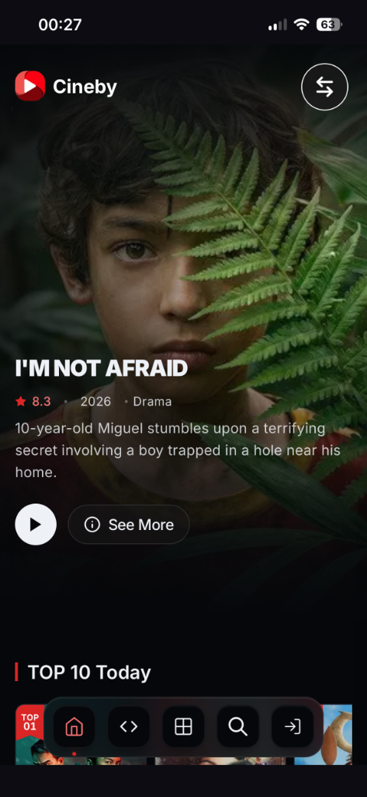
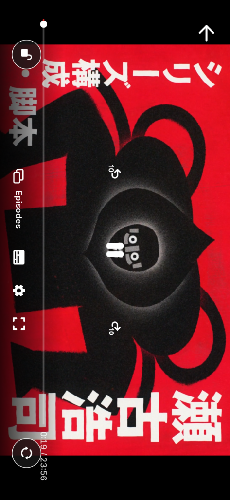

<div align="center">

# Mstream iOS

An iOS wrapper for the **Cineby** (movies and series) and **Nimegami** (anime) streaming portals, using a `WKWebView` shell that patches the shortcomings of their web players.

[](#)
[](https://swift.org)
[](https://developer.apple.com/ios/)

**English** · [Bahasa Indonesia](README.id.md)

</div>

---

## Why It Exists

The web players on both portals have three problems on iPhone:

1. **Screen Rotation Lock** blocks landscape mode, so video only plays in portrait.
2. **The player never goes truly fullscreen** — margins and safe areas remain.
3. **There is no way to lock the screen** while watching, so an accidental touch pauses the video or seeks.

Mstream fixes all three on the native side, without modifying the sites.

## Features

### Bypass Orientation Lock
Fullscreen landscape still works while **Screen Rotation Lock** is enabled. Implemented in `AppDelegate.swift` via `supportedInterfaceOrientationsFor`.

### Netflix-Style Playback Lock
A red lock button disables all touch interaction on the WebView — preventing accidental pause/seek while also blocking pop-ups and ad clicks triggered by scripts.

- Auto-hides after 3 seconds without interaction.
- Tap anywhere to show or hide the lock button.

### Floating Controls
Circular 50×50 controls using **SF Symbols**, replacing the navigation header in both portrait and landscape.

- **Context-sensitive rotate button** — appears only when a `<video>` element is detected on the page, and hides while browsing lists or descriptions.

### Edge-to-Edge Fullscreen
Overrides the HTML `viewport` and safe-area margins in landscape so video fills the screen.

### Multi-Portal
A portal picker on launch (Cineby or Nimegami), plus a floating switch button with a cross-dissolve transition. The switch button hides automatically while watching video in landscape.

## Screenshots

| Portrait | Landscape (player) |
| --- | --- |
|  |  |

## Tech Stack

| Layer | Technology |
| --- | --- |
| Language | Swift 5 |
| UI | UIKit (`UIViewController`, `UINavigationController`) |
| Web | `WKWebView` + `WKUserScript` |
| Build | Xcode + GitHub Actions (signed and unsigned) |
| Alternative | Capacitor wrapper in `capacitor-app/` |

## Project Layout

```
ios-cineby/                            # native sources (Swift)
  AppDelegate.swift                    # orientation lock bypass
  SceneDelegate.swift
  WebViewController.swift              # core: player, floating controls, lock
  OrientationNavigationController.swift
capacitor-app/                         # Capacitor wrapper + web assets
  capacitor.config.json
  patch_ios.sh                         # patches the generated iOS project
fastlane/                              # Appfile, Fastfile, Matchfile (signing)
.github/workflows/
  ios-build.yml                        # signed build
  ios-build-unsigned.yml               # unsigned IPA build
screenshots/
```

## Building

This repo **does not commit an `*.xcodeproj`** — Capacitor generates the iOS project at build time. There are two paths.

### A. Unsigned IPA via GitHub Actions (easiest)

The `ios-build-unsigned.yml` workflow runs on push to `main`/`master`, or manually from the **Actions → Run workflow** tab. It produces an artifact containing an unsigned IPA, ready for Sideloadly/AltStore.

### B. Local build

Requires macOS and Xcode.

```bash
cd capacitor-app
npm install
npx @capacitor/cli add ios --packagemanager SPM   # once only
npx @capacitor/cli copy ios
bash patch_ios.sh

cd ios/App
xcodebuild -workspace App.xcworkspace -scheme App -configuration Release \
  -sdk iphoneos archive -archivePath build/App.xcarchive CODE_SIGNING_ALLOWED=NO
```

Once the project is generated you can also open it in Xcode:

```bash
open ios/App/App.xcworkspace
```

The workflow forces `IPHONEOS_DEPLOYMENT_TARGET` to **26.0** across the Podfile, `project.pbxproj`, and `.xcconfig`. If a local build fails on deployment target, that is why.

### Sideloading

Install the IPA with **Sideloadly** or **AltStore**. Building to a physical device requires an Apple Developer signing certificate.

## Usage

1. Open the app and choose a portal (Cineby / Nimegami).
2. Pick a title and start watching.
3. Rotate to landscape — fullscreen engages even with Rotation Lock on.
4. Tap the red lock button to lock the screen while watching.

## Disclaimer

This project is a client only. All content comes from third parties; this repo does not host or distribute any copyrighted material. Use it responsibly and respect each portal's terms of service.

---

<div align="center">
Built by <a href="https://github.com/Ilhamaji">Ilham Aji</a>
</div>
